## How the code is organised (SOLID)

Every class lives in a package (folder) according to the kind of job it does. The diagram shows all 64 classes in `src/main/java`, grouped by package.

How to read the arrows:

- `<|--` (solid line, hollow triangle): **extends** a class
- `<|..` (dotted line, hollow triangle): **implements** an interface
- `-->` (plain arrow): **uses**

Classes in `exception` and `util` are used almost everywhere, so only their inheritance is drawn.

```mermaid
classDiagram
    direction LR

    namespace app {
        class Main
    }

    namespace ui {
        class ConsoleIO
        class ConsoleMenu
        class Screen {
            <<interface>>
        }
        class InputCheck {
            <<interface>>
        }
        class StudentLookup
        class StudentDetailsView
    }

    namespace screens {
        class AddStudentScreen
        class ViewStudentsScreen
        class RecordGradeScreen
        class GradeReportScreen
        class ExportReportScreen
        class GpaScreen
        class BulkImportScreen
        class StatisticsScreen
        class SearchScreen
    }

    namespace service {
        class StudentManager
        class GradeManager
        class SubjectCatalog
        class GPAService
        class StatisticsService
        class SearchService
        class ReportGenerator
        class ReportType {
            <<enumeration>>
        }
        class ExportService
        class ExportResult
        class BulkImportService
        class ImportResult
        class SampleDataLoader
    }

    namespace calculator {
        class Calculable {
            <<interface>>
        }
        class GradingScale {
            <<interface>>
        }
        class FourPointGradingScale
        class GPACalculator
        class StatisticsCalculator
    }

    namespace io {
        class CSVParser {
            <<interface>>
        }
        class SimpleCSVParser
        class CsvRecord
        class FileExporter {
            <<interface>>
        }
        class TextFileExporter
        class ImportFolder
    }

    namespace model {
        class Searchable {
            <<interface>>
        }
        class Exportable {
            <<interface>>
        }
        class Student {
            <<abstract>>
            +getStudentType()
            +getPassingGrade()
            +isPassing(average)
            +isHonorsEligible(average)
        }
        class RegularStudent
        class HonorsStudent
        class Subject {
            <<abstract>>
        }
        class CoreSubject
        class ElectiveSubject
        class Grade
    }

    namespace exception {
        class GradeSystemException
        class StudentNotFoundException
        class InvalidGradeException
        class InvalidFileFormatException
        class SubjectNotFoundException
        class InvalidInputException
        class NoGradesException
        class FileImportException
        class FileExportException
        class InputClosedException
    }

    namespace util {
        class AppConstants
        class AppLogger
        class InputValidator
        class MathUtils
        class TextFormat
    }

    %% Start-up and menu
    Main --> ConsoleMenu
    ConsoleMenu --> Screen
    ConsoleMenu --> ConsoleIO
    ConsoleIO --> InputCheck
    ConsoleIO --> GradeSystemException
    StudentLookup --> StudentManager
    StudentDetailsView --> GradeManager

    %% Every menu option is a Screen
    Screen <|.. AddStudentScreen
    Screen <|.. ViewStudentsScreen
    Screen <|.. RecordGradeScreen
    Screen <|.. GradeReportScreen
    Screen <|.. ExportReportScreen
    Screen <|.. GpaScreen
    Screen <|.. BulkImportScreen
    Screen <|.. StatisticsScreen
    Screen <|.. SearchScreen

    %% Services
    StudentManager --> Student
    GradeManager --> Grade
    SubjectCatalog --> Subject
    GPAService --> GPACalculator
    StatisticsService --> StatisticsCalculator
    SearchService --> StudentManager
    ReportGenerator --> GradeManager
    ReportGenerator --> ReportType
    ExportService --> ReportGenerator
    ExportService --> FileExporter
    ExportService --> ExportResult
    BulkImportService --> CSVParser
    BulkImportService --> FileExporter
    BulkImportService --> SubjectCatalog
    BulkImportService --> ImportResult
    SampleDataLoader --> StudentManager

    %% Calculators
    Calculable <|.. GPACalculator
    GradingScale <|.. FourPointGradingScale
    GPACalculator --> GradingScale

    %% Files
    CSVParser <|.. SimpleCSVParser
    CSVParser --> CsvRecord
    FileExporter <|.. TextFileExporter
    ImportFolder --> FileExporter

    %% Model
    Searchable <|.. Student
    Exportable <|.. Student
    Exportable <|.. Grade
    Student <|-- RegularStudent
    Student <|-- HonorsStudent
    Subject <|-- CoreSubject
    Subject <|-- ElectiveSubject
    Grade --> Subject

    %% Exceptions
    GradeSystemException <|-- StudentNotFoundException
    GradeSystemException <|-- InvalidGradeException
    GradeSystemException <|-- InvalidFileFormatException
    GradeSystemException <|-- SubjectNotFoundException
    GradeSystemException <|-- InvalidInputException
    GradeSystemException <|-- NoGradesException
    GradeSystemException <|-- FileImportException
    GradeSystemException <|-- FileExportException
```

### What each file does

Each class has one job (Single Responsibility).

**`com.gradesystem` (the root)**

| File | Its one job |
|---|---|
| `Main` | Creates every object, connects them, and starts the menu |

**`ui`: talking to the user**

| File | Its one job |
|---|---|
| `ConsoleIO` | Reads input and prints output for every screen |
| `ConsoleMenu` | Shows the main menu and runs the chosen screen |
| `Screen` | Interface every menu option implements (label, `[NEW]` tag, `show()`) |
| `InputCheck` | Interface for an input rule, so one "ask until valid" loop fits every field |
| `StudentLookup` | Asks for a student ID until a student is found or the user gives up |
| `StudentDetailsView` | Prints all details of one student |

**`ui.screens`: one class per menu option**

| File | Its one job |
|---|---|
| `AddStudentScreen` | Option 1: asks for a new student's details |
| `ViewStudentsScreen` | Option 2: lists all students with their averages |
| `RecordGradeScreen` | Option 3: records one grade for one student |
| `GradeReportScreen` | Option 4: shows a student's report on screen |
| `ExportReportScreen` | Option 5: saves a student's report to a file |
| `GpaScreen` | Option 6: shows a student's GPA, rank and analysis |
| `BulkImportScreen` | Option 7: imports grades from a CSV file |
| `StatisticsScreen` | Option 8: shows class-wide statistics |
| `SearchScreen` | Option 9: searches students and acts on the results |

**`service`: the school's rules**

| File | Its one job |
|---|---|
| `StudentManager` | Stores students and finds them by ID |
| `GradeManager` | Stores grades and calculates averages |
| `SubjectCatalog` | Knows which subjects exist |
| `GPAService` | Works out a student's GPA and class rank |
| `StatisticsService` | Collects class-wide numbers for the statistics screen |
| `SearchService` | Finds students by ID, name, average range or type |
| `ReportGenerator` | Builds the text of a report |
| `ReportType` | Lists the report kinds: summary, detailed or both |
| `ExportService` | Builds a report and has it saved to a file |
| `ExportResult` | Holds where an exported file was saved and its size |
| `BulkImportService` | Checks each CSV row and imports the valid ones |
| `ImportResult` | Holds the outcome of an import (totals and failures) |
| `SampleDataLoader` | Adds 5 sample students and their grades (used by the tests) |

**`calculator`: pure math**

| File | Its one job |
|---|---|
| `Calculable` | Interface for "turn a list of grades into one number" |
| `GradingScale` | Interface for converting percentages to GPA points and letters |
| `FourPointGradingScale` | The 4.0 scale table (93% = 4.0 A, 90% = 3.7 A-, ...) |
| `GPACalculator` | Turns grades into a cumulative GPA |
| `StatisticsCalculator` | Mean, median, mode, standard deviation and grade bands |

**`io`: files**

| File | Its one job |
|---|---|
| `CSVParser` | Interface for reading a CSV file into rows |
| `SimpleCSVParser` | Reads a CSV file and checks its header |
| `CsvRecord` | Holds one row of a CSV file and its row number |
| `FileExporter` | Interface for writing text to a file |
| `TextFileExporter` | Writes text to a file, creating the folder if needed |
| `ImportFolder` | Prepares the `imports/` folder and lists its CSV files |

**`model`: the data**

| File | Its one job |
|---|---|
| `Searchable` | Interface for "can be found by part of its name" |
| `Exportable` | Interface for "can be written as one line of a file" |
| `Student` | Abstract parent holding one student's data |
| `RegularStudent` | A student who passes at 50% |
| `HonorsStudent` | A student who passes at 60% and can be honors eligible |
| `Subject` | Abstract parent holding one subject's name and code |
| `CoreSubject` | A mandatory subject |
| `ElectiveSubject` | An optional subject |
| `Grade` | Holds one grade, and refuses invalid values |

**`exception`: what can go wrong**

| File | Its one job |
|---|---|
| `GradeSystemException` | Parent of all custom exceptions; adds a recovery hint |
| `StudentNotFoundException` | No student has the given ID |
| `InvalidGradeException` | A grade isn't a number or isn't 0-100 |
| `InvalidFileFormatException` | A CSV file is empty, has no rows or a wrong header |
| `SubjectNotFoundException` | A subject or subject type doesn't exist |
| `InvalidInputException` | Typed input breaks a rule (name, email, phone, file name...) |
| `NoGradesException` | A GPA or report was requested for a student without grades |
| `FileImportException` | A CSV file is missing or can't be read |
| `FileExportException` | A file can't be written |
| `InputClosedException` | The console input ended, so the program closes politely |

**`util`: shared helpers**

| File | Its one job |
|---|---|
| `AppConstants` | Holds every fixed value (no magic numbers) |
| `AppLogger` | Sets up timestamped logging to `logs/app.log` |
| `InputValidator` | Checks input against the rules |
| `MathUtils` | Shared formulas: average and percentage |
| `TextFormat` | Formats numbers as text (percentages, GPA, bars) |
